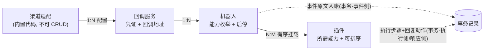
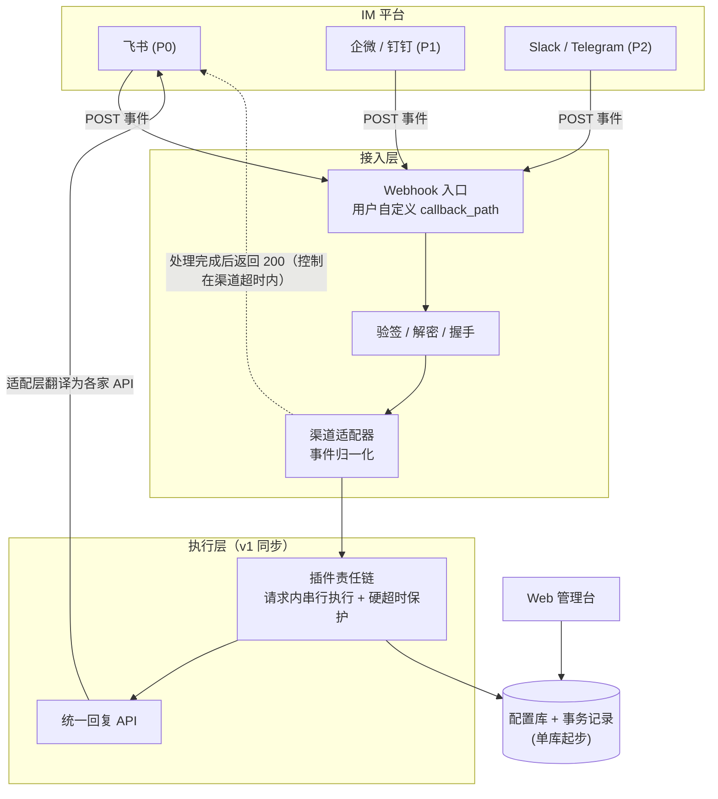
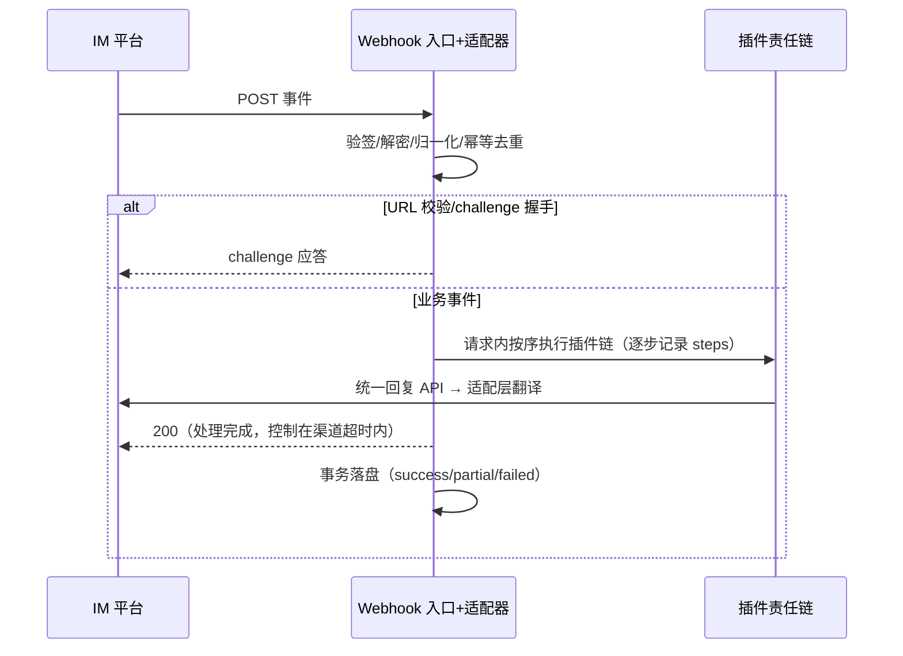

# IM 机器人回调管理平台 · 需求文档

- 版本：v0.2（2026-11-07）
- 项目名：`im-bot-router`
- 状态：需求基线。v0.2 依据 P0 探针**实测修订**（群@/私聊端到端已验证，样本在 `docs/samples/`），修订原则：**不过度设计**——能同步不异步、能单表不分层、单渠道不做映射表。第 11 节 ADR 中 D1/D6 已按实测+需求方意见调整。

---

## 1. 项目定位

把飞书、企业微信、钉钉、Slack、Telegram 等渠道的自建机器人统一接入：

> **一套 Web 管理台 + 统一回调接入 + 归一化事件模型 + 插件化业务执行 + 全量事务记录**

飞书为第一个适配渠道（P0）。

## 2. 术语表

| 术语 | 定义 |
|---|---|
| 渠道（Channel） | 一种 IM 平台（飞书/企微/钉钉/Slack/Telegram）及其适配实现 |
| 回调服务（Callback Service） | 在 IM 平台上创建的一个"应用"实例及其回调配置（凭证 + 回调地址） |
| 机器人（Bot） | 挂在回调服务下的执行体，**平台管理的最小粒度**，声明能力枚举 |
| 插件（Plugin） | 可插拔的业务逻辑单元，声明所需能力，挂载到机器人上按序执行 |
| 事务（Transaction） | 一次事件在机器人上触发的完整处理过程（插件链执行 + 回复），落库即事务记录 |
| 统一事件（Unified Event） | 各渠道原始事件归一化后的平台内部标准事件模型 |
| 能力（Capability） | 机器人具备（插件所需）的权限语义枚举，如 `im:message.reply` |

## 3. 背景与问题域

- 主流 IM 自建机器人收消息走**事件订阅 Webhook**。v1 只处理两种触发场景：**群聊里 @机器人**、**用户与机器人私聊**（其余如群聊普通消息不触发）→ IM 平台将事件 POST 到开发者配置的回调地址。
- **一个回调地址可承载多个机器人**，用「渠道 + 回调服务 + 机器人」即可唯一定位来源。
- 各渠道事件**格式不同、语义一致** → 归一化是平台核心价值：插件一次开发、多渠道可挂。
- 各渠道对回调响应有秒级超时且失败重推。官方文档口径：[飞书事件回调须 3s 内返回 200，超时进入重推队列，at-least-once 投递（须自行幂等）](https://open.feishu.cn/document/event-subscription-guide/event-subscriptions/event-callback-optimization-guide?lang=zh-CN)；[企微 5s 内收不到响应即断连并重新发起请求，共重试 3 次](https://developer.work.weixin.qq.com/document/path/90930)。**目标场景为内网 IM 的 POST 回调（v0.2 明确），各渠道实际超时规格接入时实测，不预先设计**。结论：处理须在渠道超时内完成——v1 用同步快处理满足（实测全链路 ~750ms，见 §6.4）。

## 4. 核心领域模型



### 4.1 实体与属性

| 实体 | 关键属性 | 职责 |
|---|---|---|
| **渠道适配** | 渠道类型、适配器版本（内置） | 验签/解密、平台握手（如飞书 challenge）、原始事件→统一事件、统一回复 API→各家协议 |
| **回调服务** | 名称、渠道类型、凭证（app_id/secret/token/encrypt_key…随渠道差异）、**回调地址（平台生成，只读展示）**、启停、备注 | 承接 POST、凭路径与凭证识别来源、路由到机器人 |
| **机器人** | 名称、所属回调服务、渠道侧机器人标识、**能力枚举[]**、插件挂载[]（有序）、启停 | 接收统一事件 → 按序执行插件链 → 产生事务 |
| **插件** | 名称、版本、描述、**所需能力[]**、入口（模块路径）、启停、全局注册状态 | 对事件做具体处理与响应 |

> 说明：多数平台「应用 : 机器人 = 1:1」，模型保留 1:N 以兼容例外渠道与未来扩展。

### 4.2 能力协商

- 机器人的能力枚举来自其在 IM 平台申请应用时获批的权限，由人工在管理台勾选维护。
- 插件声明 `required_capabilities`。
- **挂载校验：`插件所需能力 ⊆ 机器人能力`**，不满足则拒绝挂载并提示缺哪些。
- 机器人能力被改小导致已挂插件不满足时：管理台给出警告，插件标记"能力不足（已禁用执行）"。

## 5. 统一事件模型

**为什么需要**：同一条"张三在群里 @小助手 查订单"，各渠道的原始报文长得完全不一样——

- 飞书：JSON，消息 ID 在 `event.message.message_id`（`om_` 前缀），发件人在 `event.sender.sender_id.open_id`，@信息以 `<at user_id="ou_xxx">` 形式嵌在 content 文本里
- 企业微信：XML，`<FromUserName>` / `<MsgId>` / `<Content>`，且回调报文有明文/加密两套
- Slack：JSON，`event.user` / `event.channel` / `event.text`（@ 是 `<@U123>` 标记），且事件流里混有 `url_verification` 握手帧需要甄别

若插件直接面向原始报文编程，一个"读发件人"就要按渠道写 N 份。归一化后插件只面向统一事件，渠道差异全部关在适配器里——**进向**：原始事件 → 统一事件；**出向**：统一回复 → 各家 API。

| 字段 | 语义 | 备注 |
|---|---|---|
| `event_id` | 平台内事件唯一 ID | 补充字段 |
| `channel` | 渠道标识 | `feishu` / `wecom` / `dingtalk` / `slack` / `telegram` |
| `service_id` / `bot_id` | 平台内路由结果 | 补充字段 |
| `sender` | 发件人 | `user_key`（平台统一键，如 `feishu:ou_xxx`）+ 渠道原生 ID + 名称 |
| `chat` | 会话上下文 | `chat_id` + `chat_type`（`p2p` / `group`） |
| `message_id` | 消息 ID | **幂等去重键**（渠道 + message_id） |
| `message_type` | 消息类型 | `text` / `image` / `file` / `audio` / … |
| `content` | 内容 | 按类型结构化 |
| `mentions` | @列表 | 判断"是否 @ 我"、@了谁 |
| `timestamp` | 事件时间 | 毫秒 |
| `raw_ref` | 原始事件引用 | 指向事务中留存的原文，补充字段 |

JSON 示例：

```json
{
  "event_id": "evt_01J...",
  "channel": "feishu",
  "service_id": "svc_01",
  "bot_id": "bot_01",
  "sender": { "user_key": "feishu:ou_xxx", "user_id": "ou_xxx", "name": "张三" },
  "chat": { "chat_id": "oc_xxx", "chat_type": "group" },
  "message": {
    "message_id": "om_xxx",
    "message_type": "text",
    "content": { "text": "@小助手 帮我查订单 10086" },
    "mentions": [ { "user_key": "feishu:bot_01", "name": "小助手" } ],
    "timestamp": 1762502400000
  },
  "raw_ref": "txn_9f2c"
}
```

## 6. 关键机制

### 6.1 事件归一化
渠道适配器把各家原始 payload 转成统一事件；机器人/插件只面向统一模型编程。

### 6.2 插件管道（执行语义）
- **串行责任链**：机器人挂载的插件按配置顺序串行执行。
- **可短路**：插件返回 `handled` 则终止后续插件（表达"已处理"）；返回 `next` 则继续。
- **事件只读**：统一事件对象对插件不可变；插件间通过**共享上下文 `shared`** 传递数据。
- **异常隔离**：单插件抛异常 → 记录错误、事务标记 `partial`、默认继续执行后续插件。
- 插件接口（语言中立概念，具体 API 在技术方案定义）：

```
Plugin = {
  meta:   { name, version, required_capabilities: [...] }
  on_event(ctx) -> "next" | "handled" | { action: ... }
}
ctx = { event(只读), shared(可写), reply(统一回复 API 句柄), logger }
```

### 6.3 回复通路
- 平台提供**统一回复 API**（`ctx.reply`），插件不直接调各家 IM 接口。
- 渠道适配层把统一回复翻译成对应平台协议（如飞书回复消息接口）。
- 每次回复动作（成功/失败）计入事务记录。

### 6.4 接收与执行（v0.2 依实测简化：同步）
- v1 **同步执行**：入口完成验签/解密/归一化/去重后，在请求内直接跑完插件链再返回 200。实测依据：echo 插件全链路 ~750ms，飞书 3s 超时余量充足；内网 IM 延迟可控。
- 插件契约**约定快速返回**（调慢速外部接口是插件自己的责任）；入口设**硬超时保护**，超时截断并把事务记 `partial/failed`。
- 队列/Worker 异步为 **P1 升级项**（出现常态慢插件或重推加剧时再上），只替换执行段，入口契约不变。

### 6.5 幂等
- IM 平台超时/失败会重推事件。以 **`channel + message_id`（+ 事件类型）唯一键**去重。
- 命中重复 → 不再执行插件链，记一条 `dedup` 状态的事务（保留证据链）。

## 7. 事务记录模型

一次事件的处理 = 一条事务：

```
Transaction
├── id, status: success | partial | failed | dedup（v1 同步执行无中间态；升级队列后才有 pending/running）
├── 事件侧
│   ├── channel, service_id, bot_id
│   ├── raw_payload        # 渠道原始事件全文
│   └── unified_event      # 归一化事件
├── 执行侧 steps[]         # 按执行顺序
│   └── plugin, order, result(success|failed|skipped), duration_ms, error
├── 响应侧 replies[]
│   └── api, target(chat), result, error
└── created_at, ack_at, finished_at
```

用途：审计、排障、统计。事件重放**不在 v1 范围**（见非目标）。

一条真实事务的完整示例（插件 1 失败、插件 2 成功，对应验收场景 4）：

```json
{
  "id": "txn_9f2c",
  "status": "partial",
  "event_side": {
    "channel": "feishu", "service_id": "svc_01", "bot_id": "bot_01",
    "raw_payload": { "schema": "2.0", "header": { "event_type": "im.message.receive_v1", "...": "飞书原始报文全文留存" } },
    "unified_event": { "...": "§5 统一事件全文" }
  },
  "steps": [
    { "plugin": "help",        "order": 1, "result": "failed",  "duration_ms": 12,  "error": "config missing: help.template" },
    { "plugin": "order-query", "order": 2, "result": "success", "duration_ms": 340 }
  ],
  "replies": [
    { "api": "im:message.reply", "target": "oc_xxx", "result": "success", "content_brief": "订单 10086 已发货" }
  ],
  "created_at": "2026-11-07T10:00:00.096Z",
  "ack_at": "2026-11-07T10:00:00.120Z",
  "finished_at": "2026-11-07T10:00:00.500Z"
}
```

## 8. Web 管理台功能清单（v1）

| 模块 | 功能点 |
|---|---|
| 回调服务 | 列表/新建/编辑/启停；选择渠道、填凭证；**回调地址展示与复制**（拿去给 IM 负责人配置）；连通性自检（challenge 握手 + 事件订阅权限就绪校验——实测坑①②的防线） |
| 机器人 | 列表/新建/编辑/启停；所属回调服务；渠道侧机器人标识；**能力枚举勾选** |
| 插件 | 已注册插件列表（自动发现）；启停；挂载/卸载到机器人；**拖拽排序**；能力匹配校验与缺失提示 |
| 事务记录 | 列表：按 渠道/机器人/状态/时间 筛选；详情：原始事件、统一事件、插件执行步骤、回复记录 |
| 系统 | 单管理员登录 |

仪表盘（事件量/成功率统计）放 P1。

## 9. 架构总览与事件流转





## 10. 渠道路线图

| 阶段 | 渠道 | 适配要点 |
|---|---|---|
| P0 | **飞书** | 事件订阅：URL 校验 challenge（原样返回）、Encrypt Key AES 解密、Verification Token 校验；约 3s 响应超时与重推（以验收场景 7 实测复核）；消息事件 `im.message.receive_v1`（群内 @ 与私聊）；凭证 app_id/app_secret（tenant_access_token）。**实测坑（2026-11-07 探针验证）**：①事件推送不认 `im:message` 大权限，须细粒度 `im:message.group_at_msg:readonly`（群@收）+ `im:message.p2p_msg:readonly`（单聊收）；②长连接模式可能静默失败（无报错无事件），必须校验 `ws client ready` 后才算可用——两坑均已在本项目测试应用上复现并修复，样本见 `docs/samples/` |
| P1 | 企业微信、钉钉 | 企微：回调验签（msg_signature/CorpID）、5s 超时、被动回复与主动回复之分；钉钉：Stream 模式 vs HTTP 回调二选一（到时定） |
| P2 | Slack、Telegram | Slack：Events API 签名校验 + url_verification；Telegram：setWebhook + secret_token |

## 11. 决策记录（ADR）——均为默认采纳，待确认可推翻

| # | 决策点 | 结论 | 备选 |
|---|---|---|---|
| D1 | 接收与执行衔接 | **v1 同步执行**（请求内跑完插件链再返回 200；插件约定快速返回 + 入口硬超时保护；实测全链路 ~750ms）。队列/Worker 异步 = P1 升级项 | 秒回 ACK+队列异步（P1）/消息中间件 |
| D2 | 回调 URL 设计 | 每服务自定义 `callback_path`（如 `/message/event`），精确路径路由，全局唯一 | 写死 `/hooks/{channel}/{id}`；单入口靠 body/header 路由 |
| D3 | 插件形态 | **进程内插件**：plugins/ 目录自动发现加载，主语言绑定 | 外部 HTTP 插件（语言无关、隔离好、运维重） |
| D4 | 插件执行语义 | 串行责任链：可短路、事件只读、shared 上下文、异常隔离默认继续 | 纯广播 / 可变管道 |
| D5 | 回复通路 | 平台统一回复 API，适配层翻译，回复计入事务 | 插件直调各家 API（破坏归一化，否） |
| D6 | 能力枚举口径 | v1 只定少量统一语义枚举（`im:message.read` / `im:message.reply` 起步），先只覆盖飞书；**渠道映射表 P1 再建**（单渠道时无映射可言）。实测补充：能力校验防不住"权限配错→事件不推"（§10 实测坑①），由连通性自检兜底 | 直接用各家原生权限名（插件无法跨渠道复用，否） |
| D7 | 幂等 | `channel + message_id + 事件类型` 唯一键去重；重复记 `dedup` 事务 | 不去重（重复执行业务，否） |
| D8 | 管理台账号 | v1 单管理员，凭证走环境变量/配置文件 | 多用户+角色（团队共用时再做） |

## 12. 非目标（v1 明确不做）

- 多租户 / 多组织隔离
- 多用户与角色权限体系
- 外部进程（HTTP/gRPC）插件通道
- 事件重放（按事务重新驱动插件链）
- 非消息类事件（卡片交互回调、群事件、菜单事件等）——架构预留，渠道适配到 P1 再定
- 仪表盘与统计报表（P1）

## 13. 验收场景（P0 关键路径）

1. **端到端**：飞书群里 @机器人 发"帮助" → 帮助插件命中并回复 → 管理台事务详情可见：原文、统一事件、插件执行步骤、回复记录，状态 success。
2. **能力协商**：给机器人只勾 `im:message.read`，尝试挂载需要 `im:message.reply` 的插件 → 挂载被拒绝，提示缺失能力。
3. **幂等**：模拟平台重推同一事件 → 第二次仅记 `dedup` 事务，插件链不重复执行。
4. **异常隔离**：插件 B 抛异常 → 事务标记 partial，插件 C 仍执行，步骤记录含 B 的错误详情。
5. **排序生效**：调整插件顺序后，事务 steps 的执行顺序与配置一致。
6. **超时保护**：慢插件被入口硬超时截断，响应仍在渠道超时窗口内返回；事务记 `partial/failed`（v1 同步模式的保护机制，常态慢插件出现时触发 D1 队列化升级）。
7. **超时/重推实测（接入真实渠道时做，不预先设计）**：接入公司真实 IM 渠道时，按该渠道实际超时规格做一轮延迟实测并回填本文档。目标场景为内网 POST，飞书官方云的 3s/重推参数仅供参考。
